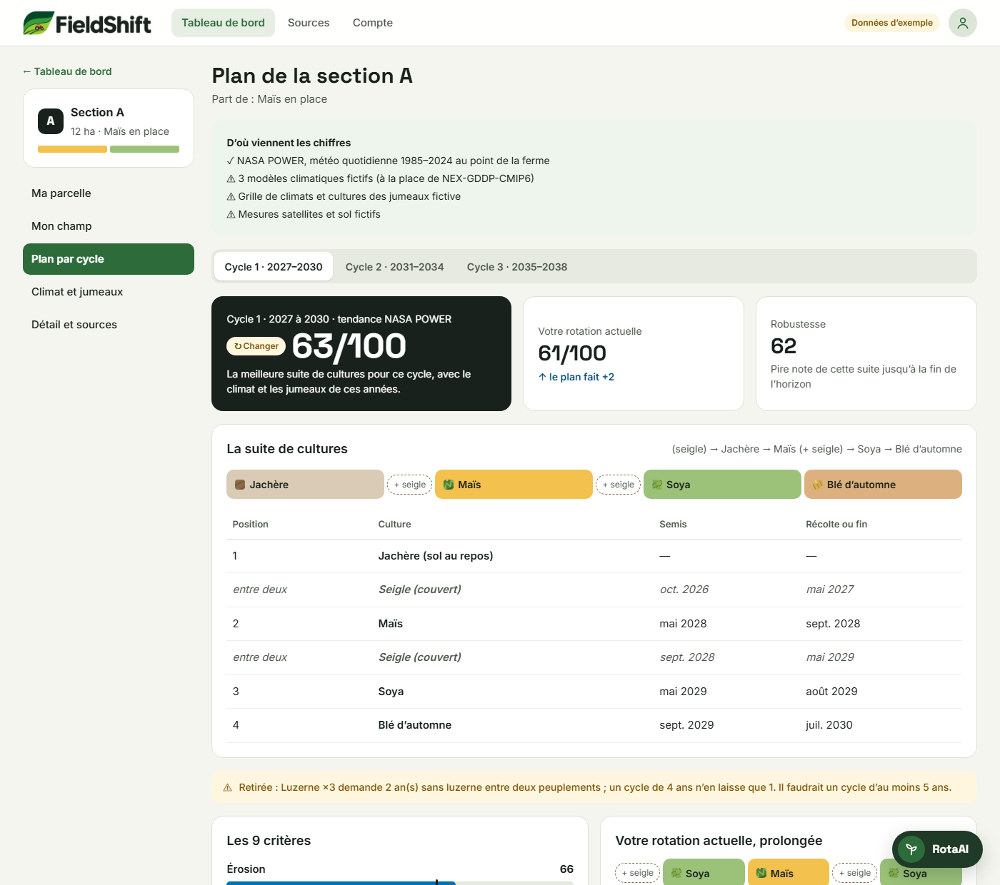
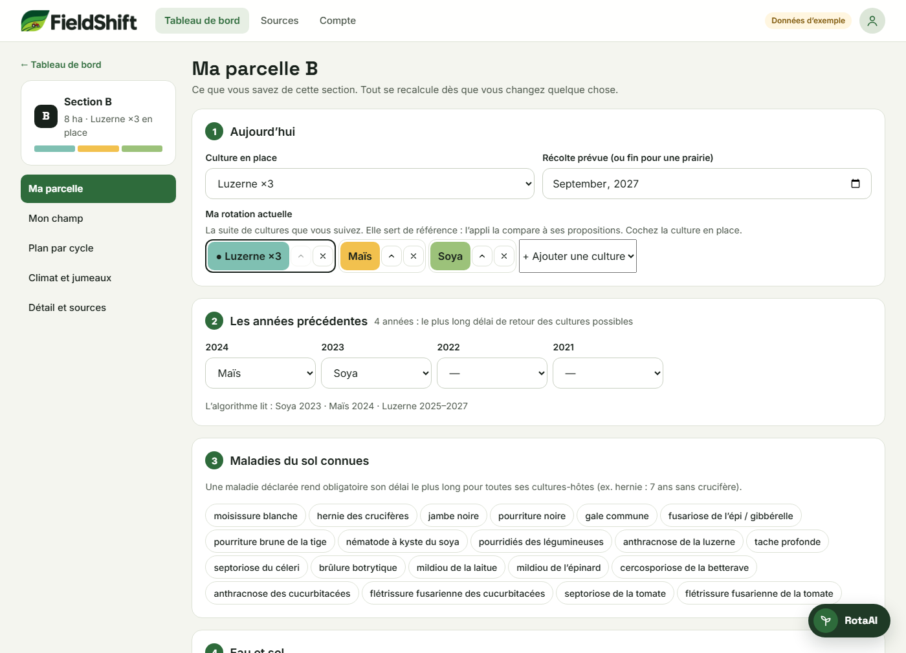

# Field Shift 🌱

**Choisir ses rotations grâce au jumeau climatique de sa ferme, avec les données de la NASA.**

Projet de l'équipe **NASA-LARPERS** pour le [NASA Space Apps Challenge 2026](https://www.spaceappschallenge.org/2026/) (14 et 15 novembre), défi _Field Shift: Adapting Farms with NASA Data_.

> « Pendant chacun de tes prochains cycles, ta ferme aura un climat qu'un autre endroit a déjà connu. Voici les rotations qui y ont marché, adaptées à ta parcelle, à tes semences et à tes priorités. »

> **v3.0 · l'algorithme tourne dans l'appli.** L'algorithme _Field Shift v5.1_ est codé en JavaScript dans `backend/algorithm/` et vérifié contre sa référence Python. La météo de la ferme vient vraiment de NASA POWER ; les modèles climatiques, les jumeaux et les mesures satellites sont encore des données d'exemple (badge « Données d'exemple », détail en haut de chaque écran).


## Ce que fait l'appli

1. Le fermier crée son compte, place sa ferme sur la carte et la **découpe en sections** A, B, C…
2. Pour chaque section, il dit **ce qui pousse**, quand ce sera récolté et la **rotation qu'il suit** ; il coche les **semences** qu'il a déjà.
3. Il choisit la **durée du cycle**, le nombre de cultures par an et l'**horizon**, puis classe les **9 critères** qui comptent pour lui (rendement, eau, fourrage, azote, érosion, matière organique, marché, ravageurs, réserve).
4. Pour chaque section et chaque cycle, l'algorithme :
   - calcule le **climat** que la ferme aura (tendance des 40 ans de NASA POWER, puis modèles climatiques au-delà de 10 ans) ;
   - trouve ses **jumeaux climatiques**, des endroits qui ont déjà eu ce climat entre 2011 et 2024 ;
   - garde les cultures et les enchaînements qui y marchent, au même sol ;
   - construit la **meilleure suite de cultures** : calendrier, gel, délais de retour, couverts de seigle automatiques, note sur 100 ;
   - dit s'il faut **garder ou changer** la rotation en place, et la compare à la rotation actuelle du fermier.
5. **RotaAI**, en bas à droite, répond aux « pourquoi ».

| Plan par cycle                     | Ma parcelle                                   |
| ---------------------------------- | --------------------------------------------- |
|  |  |

## Démarrer

Il faut Node.js 20 ou plus.

```bash
npm install
npm run dev        # http://localhost:5173
```

| Commande                            | Rôle                                                                    |
| ----------------------------------- | ----------------------------------------------------------------------- |
| `npm run dev`                       | serveur de développement                                                |
| `npm run build` / `npm run preview` | version de production dans `dist/`                                      |
| `npm test`                          | tests (algorithme contre la référence Python, contrat, écrans, couches) |
| `npm run lint` / `npm run format`   | qualité du code                                                         |
| `npm run fixtures`                  | régénère `backend/contract/examples/`                                   |
| `npm run check:algo -- <url>`       | vérifie qu'un algorithme distant respecte le contrat                    |

Sans réseau : `VITE_FARM_WEATHER=demo` dans `.env.local` (météo fictive).

## Architecture

Le code est rangé en **quatre couches**, une par dossier. Une couche n'importe que les couches en dessous d'elle (`npm test` le vérifie) :

| Couche          | Dossier                        | Contenu                                                                            |
| --------------- | ------------------------------ | ---------------------------------------------------------------------------------- |
| **Frontend**    | [`frontend/`](frontend/)       | la page, les écrans, les composants, les styles                                    |
| **Back end**    | [`backend/`](backend/)         | **l'algorithme** (`backend/algorithm/`), le moteur qui l'expose, le contrat        |
| **Application** | [`application/`](application/) | le contrôleur `app`, l'état, les règles des entrées du fermier, la lecture du plan |
| **Data**        | [`data/`](data/)               | cultures et fiches, délais de retour, critères, NASA POWER, adresses, sauvegarde   |

La logique métier vit seulement dans `backend/algorithm/` : une cinquantaine de petits modules, une classe ou une fonction par rôle, toutes les constantes nommées dans `backend/algorithm/config/`. Détails : [`docs/ALGORITHME.md`](docs/ALGORITHME.md) et [`docs/ARCHITECTURE.md`](docs/ARCHITECTURE.md).

## L'algorithme et sa référence

Le pipeline est décrit dans le document _Field Shift — pipeline v5.1_ et sa référence Python `field_shift.py`. La version JavaScript donne **les mêmes chaînes, décisions et notes** sur 17 plans de parcelles (9 scénarios) exportés de la référence : [`tests/algorithm/`](tests/algorithm/). Les rares écarts sont volontaires et listés dans [`docs/ALGORITHME.md`](docs/ALGORITHME.md#écarts-avec-la-référence).

## Mettre en ligne

Le workflow [`deploy.yml`](.github/workflows/deploy.yml) publie le site sur GitHub Pages à chaque push sur `main`. Une fois : **Settings → Pages → Source : GitHub Actions**. L'algorithme tourne dans le navigateur : aucun serveur n'est nécessaire. Pour un algorithme distant, ajoutez `VITE_ALGO_MODE=remote` et `VITE_ALGO_URL` dans **Settings → Secrets and variables → Actions → Variables** (voir [`docs/ALGO_CONTRACT.md`](docs/ALGO_CONTRACT.md)).

## Documentation

| Fichier                                          | Contenu                                                                       |
| ------------------------------------------------ | ----------------------------------------------------------------------------- |
| [`docs/ALGORITHME.md`](docs/ALGORITHME.md)       | L'algorithme dans le code : étapes, fichiers, classes, données, écarts, tests |
| [`docs/ALGO_CONTRACT.md`](docs/ALGO_CONTRACT.md) | Le contrat 2.0 entre l'interface et l'algorithme                              |
| [`docs/ARCHITECTURE.md`](docs/ARCHITECTURE.md)   | Les quatre couches, qui importe quoi, les écrans                              |
| [`docs/DESIGN.md`](docs/DESIGN.md)               | Base commune : couleurs, textures, typo, liste « écran fini »                 |
| [`docs/TEAM.md`](docs/TEAM.md)                   | Qui fait quoi, façon de travailler                                            |
| [`docs/ROTAAI.md`](docs/ROTAAI.md)               | L'assistant, aujourd'hui et plus tard                                         |
| [`docs/ROADMAP.md`](docs/ROADMAP.md)             | Ce qui reste à faire                                                          |

## Sources

NASA POWER (lue en direct), NEX-GDDP-CMIP6, SoilGrids 2.0, USDA Crop Sequence Boundaries et Cropland Data Layer, Inventaire annuel des cultures d'AAC, NASA HLS, SRTM / NASADEM, GPM IMERG, MODIS, SMAP L4, ECOSTRESS, GRACE-FO ; méthodes de Fitzpatrick et Dunn (2019), Peltonen-Sainio et al. (2019), Fruchtfolge (Pahmeyer et al. 2021) et du guide SARE (McGrath 2009). La liste complète, avec ce qui est réel ou encore fictif, est dans [`data/reference/sources.js`](data/reference/sources.js) et dans la page « Détail et sources ». Météo du jour : Open-Meteo. Polices : Inter et Space Grotesk (Google Fonts, licence SIL OFL).

## Utilisation de l'IA

Claude (Anthropic) a servi à la recherche d'études, aux maquettes, à l'architecture, au portage de l'algorithme en JavaScript et à une première version de ce code ; l'équipe l'a relu et le maintient. Les réponses de RotaAI sont écrites à l'avance et relues par l'équipe. Le journal détaillé sera tenu pour la déclaration de soumission.

## Limites

Le jumeau partage le climat moyen, pas la longueur du jour, les marchés ni les pratiques locales. Les modèles climatiques, les jumeaux et les mesures satellites sont encore des données d'exemple. Les fiches des cultures, les seuils et les délais de retour sont indicatifs et doivent être validés par un agronome. Field Shift aide à explorer ; il ne remplace ni le jugement du fermier ni l'expertise locale.

## Licence

[MIT](LICENSE) · NASA-LARPERS 2026
