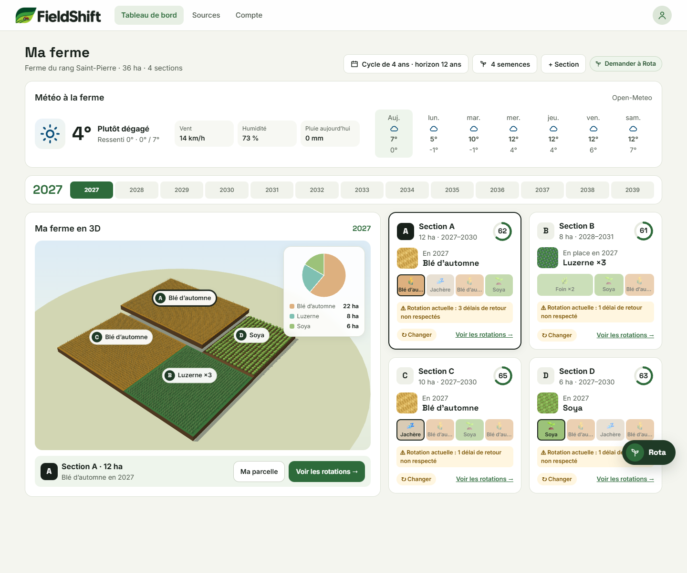

# Field Shift 🌱

**Choisir ses rotations grâce au jumeau climatique de sa ferme, avec les données de la NASA.**

Projet de l'équipe **NASA-LARPERS** pour le [NASA Space Apps Challenge 2026](https://www.spaceappschallenge.org/2026/) (14 et 15 novembre), défi _Field Shift: Adapting Farms with NASA Data_.

> « Pendant chacun de tes prochains cycles, ta ferme aura un climat qu'un autre endroit a déjà connu. Voici les rotations qui y ont marché, adaptées à ta parcelle, à tes semences et à tes priorités. »

> **v3.0 · l'algorithme est un serveur Python.** L'algorithme _Field Shift v5.1_ tourne dans un serveur FastAPI (`api/`), vérifié contre sa référence `field_shift.py` : l'appli lui envoie la ferme et affiche le plan. La météo de la ferme vient vraiment de NASA POWER ; les modèles climatiques, les jumeaux et les mesures satellites sont encore des données d'exemple (badge « Données d'exemple », détail en haut de chaque écran).



## Ce que fait l'appli

1. Le fermier crée son compte, place sa ferme sur la carte et la **découpe en sections** A, B, C…
2. Pour chaque section, il dit **ce qui pousse**, quand ce sera récolté et la **rotation qu'il suit** ; il coche les **semences** qu'il a déjà.
3. Il choisit la **durée du cycle**, le nombre de cultures par an et l'**horizon**, puis classe ses **4 priorités** : rendement, utilisation de l'eau, protection du sol et ravageurs.
4. Pour chaque section et chaque cycle, l'algorithme :
   - calcule le **climat** que la ferme aura (tendance des 40 ans de NASA POWER, puis modèles climatiques au-delà de 10 ans) ;
   - trouve ses **jumeaux climatiques**, des endroits qui ont déjà eu ce climat entre 2011 et 2024 ;
   - garde les cultures et les enchaînements qui y marchent, au même sol ;
   - construit les **trois meilleures rotations** : calendrier, gel, délais de retour, couverts de seigle automatiques, note sur 100 ;
   - dit s'il faut **garder ou changer** la rotation en place, et la compare à la rotation actuelle du fermier.
5. L'écran montre ces **trois rotations côte à côte**, chacune en roue de cultures, à côté de la rotation actuelle.
6. **Rota**, l'assistant, répond aux « pourquoi » : les écrans n'expliquent rien eux-mêmes, un bouton « Demander à Rota » ouvre l'explication.

| Rotations proposées                | Ma parcelle                                   |
| ---------------------------------- | --------------------------------------------- |
|  |  |

## Démarrer

L'appli est faite de **deux programmes** : le front (Node.js 20 ou plus) et le serveur de l'algorithme (Python 3.11 ou plus). Il faut deux terminaux.

```bash
# 1. Le serveur de l'algorithme : http://localhost:8000
cd api
python -m venv .venv
.venv\Scripts\activate          # Windows ; sous Linux et macOS : source .venv/bin/activate
pip install -e ".[dev]"
python -m uvicorn field_shift.api.main:app --port 8000
```

```bash
# 2. Le front : http://localhost:5173
npm install
npm run dev
```

Le front appelle le serveur à l'adresse `VITE_ALGO_URL` (`http://localhost:8000` par défaut avec `npm run dev`, voir [`.env.example`](.env.example)). Si le serveur est éteint, l'écran le dit et propose de réessayer. Le serveur lit toujours les données réelles (NASA POWER, SoilGrids, Copernicus DEM, MODIS) et répond `502` quand une source ne répond pas : il n'y a plus de mode démo (réglages : [`api/README.md`](api/README.md)).

| Commande                               | Rôle                                                                                   |
| -------------------------------------- | -------------------------------------------------------------------------------------- |
| `npm run dev`                          | serveur de développement du front                                                      |
| `npm run build` / `npm run preview`    | version de production dans `dist/`                                                     |
| `npm test`                             | tests du front (contrat, écrans, couches)                                              |
| `npm run lint` / `npm run format`      | qualité du code JavaScript                                                             |
| `npm run check:algo -- <url>`          | vérifie qu'un serveur respecte le contrat                                              |
| `pytest` · `ruff check .` (dans `api`) | tests et qualité du code Python : l'algorithme contre sa référence, l'API, les couches |

## Architecture

Le code est rangé en **quatre couches**, une par dossier. Une couche n'importe que les couches en dessous d'elle (`npm test` le vérifie) :

| Couche          | Dossier                        | Contenu                                                                               |
| --------------- | ------------------------------ | ------------------------------------------------------------------------------------- |
| **Frontend**    | [`frontend/`](frontend/)       | la page, les écrans, les composants, les styles                                       |
| **Back end**    | [`backend/`](backend/)         | **le serveur de l'algorithme** (`api/`, en Python), son client HTTP, le contrat       |
| **Application** | [`application/`](application/) | le contrôleur `app`, l'état, les règles des entrées du fermier, la lecture du plan    |
| **Data**        | [`data/`](data/)               | noms et couleurs des cultures, priorités, textes, ferme de démo, adresses, sauvegarde |

La logique métier vit seulement dans `api/field_shift/algorithm/` : une cinquantaine de petits modules Python, une classe ou une fonction par rôle, toutes les constantes nommées dans `algorithm/config/`. Le front et le serveur ne se parlent qu'en HTTP, selon un contrat. Détails : [`docs/ALGORITHME.md`](docs/ALGORITHME.md), [`docs/ARCHITECTURE.md`](docs/ARCHITECTURE.md) et [`api/README.md`](api/README.md).

## L'algorithme et sa référence

Le pipeline est décrit dans le document _Field Shift — pipeline v5.1_ et sa référence Python `field_shift.py`, en un seul fichier. Le serveur la redécoupe en classes et donne **les mêmes chaînes, décisions et notes** sur 17 plans de parcelles (9 scénarios) exportés de la référence : [`api/tests/`](api/tests/). Les rares écarts sont volontaires et listés dans [`docs/ALGORITHME.md`](docs/ALGORITHME.md#écarts-avec-la-référence).

## Mettre en ligne

**Tout est dans [`docs/DEPLOIEMENT.md`](docs/DEPLOIEMENT.md)** : le front sur Vercel (ou tout hébergeur de site statique, [`vercel.json`](vercel.json)), le serveur dans un conteneur Docker ([`api/Dockerfile`](api/Dockerfile), blueprint Render [`render.yaml`](render.yaml)).

Le workflow [`deploy.yml`](.github/workflows/deploy.yml) publie le front sur GitHub Pages à chaque push sur `main`. Une fois : **Settings → Pages → Source : GitHub Actions**. **L'algorithme ne tourne pas dans le navigateur : il faut héberger le serveur** (`api/`) quelque part, en HTTPS, et donner son adresse au front : variable `VITE_ALGO_URL` dans **Settings → Secrets and variables → Actions → Variables**. Sans elle, le site s'ouvre mais ne peut pas calculer de plan. Le serveur doit aussi autoriser l'adresse du site (`FIELD_SHIFT_CORS_ORIGINS`) : voir [`api/README.md`](api/README.md#héberger-le-serveur) et [`docs/ALGO_CONTRACT.md`](docs/ALGO_CONTRACT.md).

## Documentation

| Fichier                                          | Contenu                                                                       |
| ------------------------------------------------ | ----------------------------------------------------------------------------- |
| [`docs/ALGORITHME.md`](docs/ALGORITHME.md)       | L'algorithme dans le code : étapes, fichiers, classes, données, écarts, tests |
| [`docs/ALGO_CONTRACT.md`](docs/ALGO_CONTRACT.md) | Le contrat 2.0 entre l'interface et l'algorithme                              |
| [`api/README.md`](api/README.md)                 | Lancer, régler, tester et héberger le serveur de l'algorithme                 |
| [`docs/ARCHITECTURE.md`](docs/ARCHITECTURE.md)   | Les quatre couches, qui importe quoi, les écrans                              |
| [`docs/DESIGN.md`](docs/DESIGN.md)               | Base commune : couleurs, textures, typo, liste « écran fini »                 |
| [`docs/TEAM.md`](docs/TEAM.md)                   | Qui fait quoi, façon de travailler                                            |
| [`docs/ROTA.md`](docs/ROTA.md)                   | Rota, l'assistant : les boutons « Demander à Rota », aujourd'hui et plus tard |
| [`docs/ROADMAP.md`](docs/ROADMAP.md)             | Ce qui reste à faire                                                          |

## Sources

NASA POWER (lue en direct par le serveur), NEX-GDDP-CMIP6, SoilGrids 2.0, USDA Crop Sequence Boundaries et Cropland Data Layer, Inventaire annuel des cultures d'AAC, NASA HLS, SRTM / NASADEM, GPM IMERG, MODIS, SMAP L4, ECOSTRESS, GRACE-FO ; méthodes de Fitzpatrick et Dunn (2019), Peltonen-Sainio et al. (2019), Fruchtfolge (Pahmeyer et al. 2021) et du guide SARE (McGrath 2009). La liste complète, avec ce qui est réel ou encore fictif, est dans [`data/reference/sources.js`](data/reference/sources.js) et dans la page « Détail et sources ». Météo du jour : Open-Meteo. Polices : Inter et Space Grotesk (Google Fonts, licence SIL OFL).

## Utilisation de l'IA

Claude (Anthropic) a servi à la recherche d'études, aux maquettes, à l'architecture, à l'écriture de l'algorithme en classes Python (serveur FastAPI) et à une première version de ce code ; l'équipe l'a relu et le maintient. Les réponses de Rota sont écrites à l'avance et relues par l'équipe. Le journal détaillé sera tenu pour la déclaration de soumission.

## Limites

Le jumeau partage le climat moyen, pas la longueur du jour, les marchés ni les pratiques locales. Les modèles climatiques, les jumeaux et les mesures satellites sont encore des données d'exemple. Les fiches des cultures, les seuils et les délais de retour sont indicatifs et doivent être validés par un agronome. Field Shift aide à explorer ; il ne remplace ni le jugement du fermier ni l'expertise locale.

## Licence

[MIT](LICENSE) · NASA-LARPERS 2026
