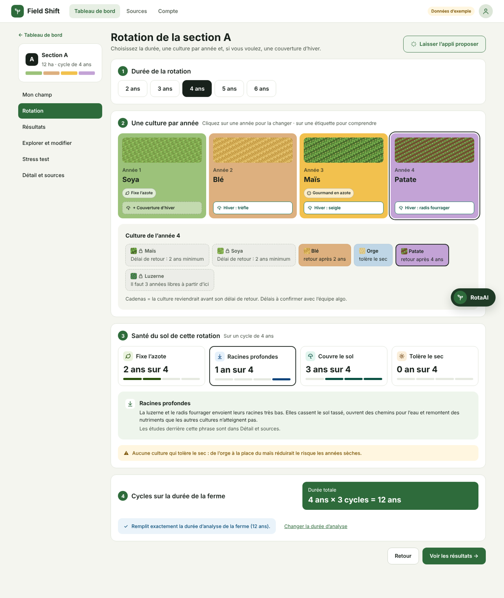
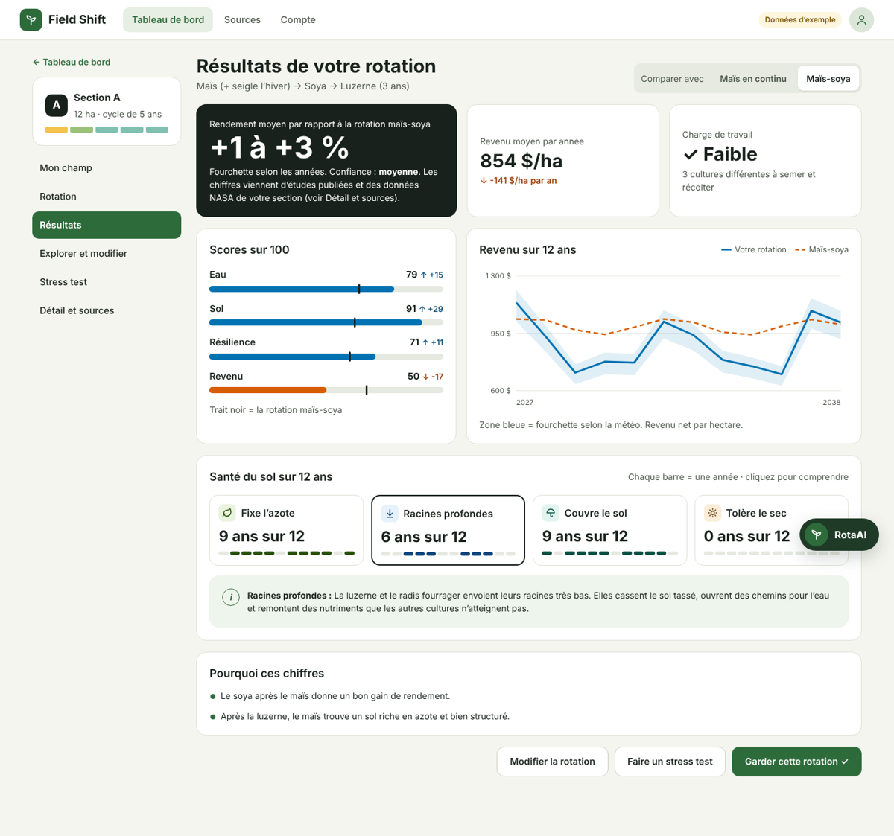

# Field Shift 🌱

**Planifier la rotation des cultures de sa ferme, section par section, avec les données de la NASA.**

Projet de l'équipe **NASA-LARPERS** pour le [NASA Space Apps Challenge 2026](https://www.spaceappschallenge.org/2026/) (14 et 15 novembre), défi _Field Shift: Adapting Farms with NASA Data_.

> **v2.0 · front end complet, algorithme en cours.** L'interface marche de bout en bout avec un moteur de démo (chiffres fictifs, badge « Données d'exemple »). Le vrai algorithme se branche sans toucher aux écrans : voir [le contrat](docs/ALGO_CONTRACT.md).


## Ce que fait l'appli

1. Le fermier crée son compte, choisit son **type de ferme** (grandes cultures ; les autres types arrivent), place sa ferme sur la carte et la **découpe en sections** A, B, C…
2. Il classe ses **priorités** : revenu, résilience, sol, eau, charge de travail.
3. Le **tableau de bord** montre chaque section, la ferme en vue isométrique avec la texture de la culture de chaque année, un curseur des années, et signale les années où l'assolement est déséquilibré (bouton « Décaler mes sections »).
4. Pour chaque section : les **données NASA** du champ, l'éditeur de **rotation** (délais de retour, cultures sur plusieurs années, couvertures d'hiver, santé du sol), les **résultats** comparés à la monoculture, **explorer et modifier** en direct, et un **stress test** (sécheresse, canicule, ravageurs).
5. **RotaAI**, en bas à droite, répond aux « pourquoi ».

| Rotation                                   | Résultats                                    |
| ------------------------------------------ | -------------------------------------------- |
|  |  |

## Démarrer

Il faut Node.js 20 ou plus.

```bash
npm install
npm run dev        # http://localhost:5173
```

| Commande                            | Rôle                                                    |
| ----------------------------------- | ------------------------------------------------------- |
| `npm run dev`                       | serveur de développement                                |
| `npm run build` / `npm run preview` | version de production dans `dist/`                      |
| `npm test`                          | tests (rotations, contrat avec l'algo, RotaAI, couches) |
| `npm run lint` / `npm run format`   | qualité du code                                         |
| `npm run fixtures`                  | régénère `backend/contract/examples/`                   |
| `npm run check:algo -- <url>`       | vérifie qu'un algorithme respecte le contrat            |

## Architecture

Le code est rangé en **quatre couches**, une par dossier. Une couche n'importe que les couches en dessous d'elle (`npm test` le vérifie) :

| Couche          | Dossier                        | Contenu                                                                   |
| --------------- | ------------------------------ | ------------------------------------------------------------------------- |
| **Frontend**    | [`frontend/`](frontend/)       | la page, les écrans, les composants, les styles                           |
| **Back end**    | [`backend/`](backend/)         | le moteur (démo ou vrai algorithme) et son contrat                        |
| **Application** | [`application/`](application/) | le contrôleur `app`, l'état, les règles métier (rotations, semences, sol) |
| **Data**        | [`data/`](data/)               | les données fixes, l'accès au réseau (météo, adresses) et à la sauvegarde |

Détails, règles d'import et « où mettre du nouveau code » : [`docs/ARCHITECTURE.md`](docs/ARCHITECTURE.md).

## Brancher l'algorithme

Le front parle à l'algo à travers **un contrat** : trois routes `POST` en JSON, décrites dans [`docs/ALGO_CONTRACT.md`](docs/ALGO_CONTRACT.md) et [`backend/contract/field-shift.schema.json`](backend/contract/field-shift.schema.json).

```bash
cp .env.example .env.local
# VITE_ALGO_MODE=remote
# VITE_ALGO_URL=http://localhost:8000
npm run check:algo -- http://localhost:8000
npm run dev
```

Pour l'équipe algo : [`docs/PROMPT_ALGO.md`](docs/PROMPT_ALGO.md) est un message prêt à donner à Claude, avec la liste des fichiers à joindre.

## Mettre en ligne

Le workflow [`deploy.yml`](.github/workflows/deploy.yml) publie le site sur GitHub Pages à chaque push sur `main`. Une fois : **Settings → Pages → Source : GitHub Actions**. Pour utiliser le vrai algo en ligne, ajoutez les variables `VITE_ALGO_MODE` et `VITE_ALGO_URL` dans **Settings → Secrets and variables → Actions → Variables**.

## Documentation

| Fichier                                          | Contenu                                                        |
| ------------------------------------------------ | -------------------------------------------------------------- |
| [`docs/ALGO_CONTRACT.md`](docs/ALGO_CONTRACT.md) | Le contrat front ↔ algo                                        |
| [`docs/PROMPT_ALGO.md`](docs/PROMPT_ALGO.md)     | Message prêt à envoyer pour coder l'algo                       |
| [`docs/ARCHITECTURE.md`](docs/ARCHITECTURE.md)   | Les quatre couches, qui importe quoi, comment ajouter un écran |
| [`docs/DESIGN.md`](docs/DESIGN.md)               | Base commune : couleurs, textures, typo, liste « écran fini »  |
| [`docs/TEAM.md`](docs/TEAM.md)                   | Qui fait quoi, façon de travailler                             |
| [`docs/ROTAAI.md`](docs/ROTAAI.md)               | L'assistant, aujourd'hui et plus tard                          |
| [`docs/ROADMAP.md`](docs/ROADMAP.md)             | Ce qui reste à faire                                           |

## Sources

Les données NASA (POWER, GPM IMERG, SMAP, ECOSTRESS, HLS, NEX-GDDP-CMIP6), SoilGrids et les études utilisées sont listées dans [`data/reference/sources.js`](data/reference/sources.js) et dans la page « Détail et sources » de l'appli. Polices : Inter et Space Grotesk (Google Fonts, licence SIL OFL).

## Utilisation de l'IA

Claude (Anthropic) a servi à la recherche d'études, aux maquettes, à l'architecture et à une première version de ce code ; l'équipe l'a relu et le maintient. Les réponses de RotaAI sont écrites à l'avance et relues par l'équipe. Le journal détaillé sera tenu pour la déclaration de soumission.

## Limites

Les chiffres du moteur de démo sont fictifs. Les effets de rotation viennent surtout d'études menées aux États-Unis et devront être calibrés pour le Québec. Field Shift aide à décider ; il ne remplace pas l'avis d'un agronome.

## Licence

[MIT](LICENSE) · NASA-LARPERS 2026
