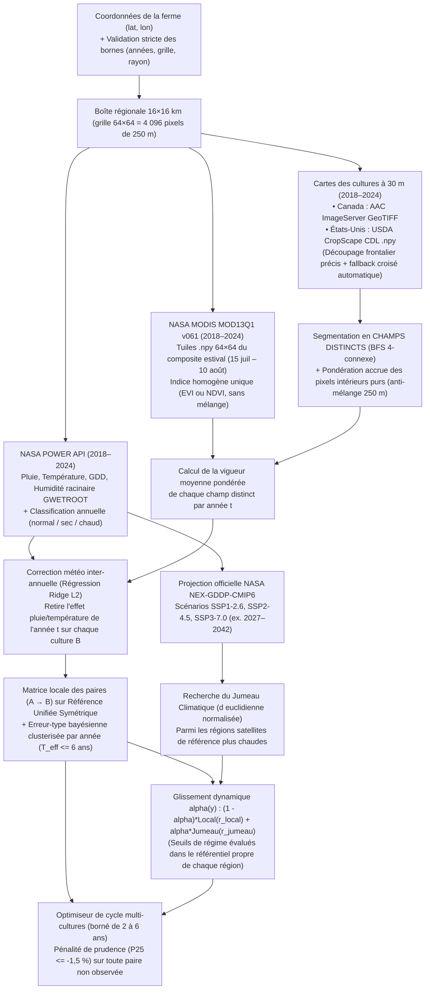

# Logique complète de l'algorithme de rendement (`algo-rendement` & `field_shift.algorithm.yield_model`)

Ce document décrit le modèle implémenté à l'identique en JavaScript ([`algo-rendement/index.js`](./index.js)) et en Python ([`api/field_shift/algorithm/yield_model/__init__.py`](../api/field_shift/algorithm/yield_model/__init__.py)), ainsi que son hypothèse conservée : les effets observés dans une région plus chaude servent de jumeau pour le climat futur de la ferme, avec un transfert progressif. Les effets des paires proviennent des observations satellites ; les poids, priors et règles de transfert sont des hypothèses explicites du modèle.

Les champs `meanYieldGainPct` et `meanFutureYieldGainPct` expriment une moyenne annuelle d'anomalies relatives de vigueur. Leur interprétation en rendement repose sur l'hypothèse de proportionnalité 1:1. Elle n'est pas ajustée sur des rendements de parcelles mesurés. La conversion NASS indique `empiricallyCalibrated: false`. Les intervalles sont des enveloppes d'incertitude du modèle, sans couverture statistique validée.

---

## 1. Vue d'ensemble du pipeline



---

## 2. Étape par étape : comment fonctionne le calcul

### Étape 1 : Validation des entrées et définition de la boîte régionale (`validateHistoricalSamplingParams` & `computeRegionBbox`)

- Avant toute requête, [`sources/cache.js`](./sources/cache.js) valide les paramètres : `lat` dans `[-80°, +80°]` (pour éviter toute explosion trigonométrique de `Math.cos(lat)` aux pôles), `lon` dans `[-180°, +180°]`, `startYear` et `endYear` entiers dans `[1981, 2030]` avec un écart maximal de `20 ans`, `gridSize` entier dans `[4, 128]` et `halfWindowKm` dans `[1, 25]`.
- À partir de `(lat, lon)`, l'algorithme trace un carré de **8 km de rayon** (`16 km × 16 km`) découpé en `64 × 64` :
  $$\frac{16\,000\text{ m}}{64\text{ pixels}} = 250\text{ m par pixel}$$
  Ce pas demandé est de 250 m pour la fenêtre par défaut. L'alignement entre couches est vérifié par leur emprise géographique et leurs dimensions ; une même résolution nominale ne suffit pas.

---

### Étape 2 : Récupération sécurisée des couches satellites (1 requête par année)

Toutes les réponses réseau sont lues via `readBoundedBuffer` / `readBoundedJson` (plafond de `10 Mo` et timeout `AbortSignal.timeout`), mises en cache de façon **atomique** (`.tmp` + `renameSync`, avec rejet des noms réservés Windows `CON`/`NUL`/`AUX`/`COM1` et validation du schéma JSON à la lecture) et vérifiées au niveau binaire par [`sources/rasterParser.js`](./sources/rasterParser.js) (`.npy` 2D/3D C-order v1/v2 et GeoTIFF 8-bit monocanal non compressé conforme à la spécification TIFF 6.0 `SamplesPerPixel=1`, `BitsPerSample=8`) :

1. **Historique des cultures ([`sources/cropHistory.js`](./sources/cropHistory.js))** :
   - **Polyligne frontalière haute précision (`isLocationInCanada`) + fusion transfrontalière (`mergeCrossBorderTilesByYear`)** : Trace la frontière Canada / États-Unis segment par segment (incluant les corridors fluviaux Détroit/Windsor, Sarnia/Port Huron, Niagara/Buffalo, Sault Ste. Marie et la diagonale Beauce/Côte-du-Sud/Maine). Si la boîte de 16 km chevauche la frontière (`isBorderStraddlingBbox`), les tuiles `AAFC_CANADA` et `USDA_CDL` sont fusionnées pixel par pixel afin de ne perdre aucune moitié de région.
   - Chaque pixel identifiable reçoit son identifiant de culture (`mais`, `soya`, `ble`, `orge`, `patate`, `luzerne`) et sa **famille botanique** (`Poaceae`, `Fabaceae`, `Solanaceae`). La classe AAFC `122` (« pâturages/fourrages ») reste inconnue (`null`) : elle inclut des graminées, du trèfle et des mélanges et ne prouve pas la présence de luzerne. USDA `36` identifie toujours la luzerne. Les nouveaux caches portent `cropMappingVersion: 2` ; les anciens caches contenant une luzerne d'origine ambiguë sont refusés et téléchargés de nouveau. Voir la [spécification AAFC, page 28](https://agriculture.canada.ca/atlas/data_donnees/annualCropInventory/supportdocument_documentdesupport/en/ISO%2019131_AAFC_Annual_Crop_Inventory_Data_Product_Specifications.pdf#page=28).

2. **Vigueur végétale estivale homogène ([`sources/nasaModisNdvi.js`](./sources/nasaModisNdvi.js) & `selectConsistentVigorIndex`)** :
   - Interroge la collection officielle **NASA MODIS `MOD13Q1 v061`** au composite de l'été (**15 juillet – 10 août**).
   - **Non-mélange EVI / NDVI** : Comme l'EVI et le NDVI n'ont pas la même échelle numérique, `selectConsistentVigorIndex` choisit **un seul indice homogène sur toute la région** (`EVI` dès que la bande EVI est présente sur la tuile MODIS, sinon `NDVI` partout), sans jamais mélanger les deux indices d'un pixel à l'autre.

3. **Météo et humidité du sol ([`sources/nasaPower.js`](./sources/nasaPower.js))** :
   - Interroge **NASA POWER Daily Agroclimatology API** sur la saison de croissance (**1er mai – 30 septembre**).
   - Si un snapshot local est présent dans `data/snapshots/nasa-power/`, vérifie que les coordonnées internes GeoJSON (`geometry.coordinates`) correspondent bien au point demandé ($\pm 0{,}25^\circ$).

---

### Étape 3 : Segmentation en champs distincts et pondération des pixels intérieurs purs (`clusterPixelsIntoDistinctFields`)

Dans [`engine/pairTransitions.js`](./engine/pairTransitions.js) :

1. Pour chaque pixel $p \in [0, 4095]$, on construit sa **signature pluriannuelle** de 2018 à 2024 :
   $$\text{Signature}(p) = \text{Culture}_{2018}(p) \mid \text{Culture}_{2019}(p) \mid \dots \mid \text{Culture}_{2024}(p)$$
2. Un parcours en largeur (**BFS 4-connexe**) regroupe les pixels contigus de même signature en une zone (`fieldId`). Cette segmentation est une approximation spatiale : elle ne démontre pas les limites de parcelles physiques.
3. **Pondération des pixels intérieurs purs (_anti-mixed-pixel_)** : Tout pixel intérieur dont les 4 voisins directs portent la même culture à l'année $t$ reçoit un poids double ($w = 2{,}0$ contre $1{,}0$ en bordure), et les parcelles disposant de pixels intérieurs purs reçoivent un poids accru ($w_f = \min(3,\; 1 + 0{,}5\,n_{\text{intérieurs}})$) pour réduire le bruit de rééchantillonnage $30\text{ m} \to 250\text{ m}$ des pixels isolés de bordure.

---

### Étape 4 : Centrage météo inter-annuel (Ridge $L_2$) et rôle de la Référence Unifiée

Une régression Ridge $L_2$ ($\lambda = 1$) est ajustée au logarithme de la vigueur, avec centrage de la réponse et des variables météo sur les observations de chaque culture cible $B$. La correction retire une composante météo multiplicative :
$$V_{\text{adj}}(f, t) = V(f, t)\,\exp\left(-\beta_{\text{pluie}, B} Z_{\text{pluie}, t} - \beta_{\text{temp}, B} Z_{\text{temp}, t}\right)$$
Pour des entrées positives et un calcul fini, la vigueur ajustée reste positive ; une erreur numérique est refusée explicitement. Les observations satellites ne sont pas modifiées ni remplacées par des valeurs fictives. Le lien logarithmique est une hypothèse du modèle de correction, pas une calibration de rendement.
_Note méthodologique :_ Comme la Référence Unifiée $\text{Réf}_{\text{unifiée}}(B, t)$ est recalculée chaque année $t$ pour la culture $B$, c'est cette référence intra-annuelle qui absorbe l'essentiel du choc météo annuel commun sur les cultures bien représentées (`mais`, `soya`, `ble`, `luzerne`). Le centrage Ridge $L_2$ n'intervient de façon significative que lorsqu'une culture $B$ compte peu de parcelles une année donnée et que sa référence s'appuie partiellement sur la moyenne pluriannuelle (`1 - wMonoYear`).

---

### Étape 5 : Référence Unifiée Symétrique et Erreur-Type Clusterisée par Année (`computeRegionalPairMatrix`)

#### 1. Référence Unifiée Symétrique par culture $B$ et année $t$

Toutes les transitions $(A \to B)$ aboutissant à la culture $B$ l'année $t$ (rotations $A \neq B$ comme monoculture $B \to B$) sont mesurées de façon **100 % symétrique** par rapport à **la même Référence Unifiée $\text{Réf}\_{\text{unifiée}}(B, t)$** :

$$\text{Réf}_{\text{unifiée}}(B, t) = \frac{1}{2}\,\overline{V}_{\text{mono, rég}}(B, t) + \frac{1}{2}\,\overline{V}_{\text{rot, rég}}(B, t)$$

$$\Delta_{A \to B}(f, t) = \frac{V_{\text{adj}}(f, t) - \text{Réf}_{\text{unifiée}}(B, t)}{\text{Réf}_{\text{unifiée}}(B, t)} \times 100$$

- **Conséquence directe :**
  1. Toutes les transitions arrivant sur la culture $B$ partagent **exactement le même dénominateur** (aucun double comptage lorsqu'on additionne les transitions d'un cycle, et aucune distorsion asymétrique entre rotation et monoculture).
  2. Le signe des écarts dépend des observations et de la référence régionale : aucune rotation ni monoculture ne reçoit de signe imposé. Les valeurs doivent être recalculées avec le mapping de cultures et la correction météo courants.
  3. **Limites d'interprétation agronomique (portée observationnelle et phénologie de la luzerne)** :
     - Les écarts mesurés par satellite entre champs en rotation et champs en monoculture sont **observationnels (corrélationnels)** et peuvent refléter des différences de pratiques ou de types de sols entre exploitants.
     - Pour la **luzerne** (`Medicago sativa`), culture pérenne fauchée 2 à 4 fois par été, la fenêtre MODIS du 15 juillet au 10 août peut coïncider avec une repousse post-fauche, ce qui accroît la dispersion apparente des transitions impliquant la luzerne.

#### 2. Erreur-Type Bayésienne Clusterisée par Année (`computeClusterRobustStdError` — variance pondérée et correction de la pseudo-réplication)

Même si une paire est observée sur des milliers de transitions de champs, tous les champs d'une même année $t$ ont vécu le même été : il n'y a donc au plus que **$T\_{\text{eff}} \le 6$ années de transition distinctes** sur 2019–2024. Diviser naïvement la variance par $\sqrt{N}$ ne tient pas compte de cette dépendance temporelle.

L'erreur-type combine donc la **variance inter-parcelles pondérée** $s_{\text{intra}, w}^2$ (calculée avec les mêmes poids de fiabilité $w_f = \min(3,\; 1 + 0{,}5\,n_{\text{intérieurs}})$ que la moyenne $\bar{\Delta}_w$) et la \**variance inter-annuelle sur les $T_{\text{eff}}$ années indépendantes** :

$$\text{SE}_{\text{cluster}}(A \to B) = \sqrt{\frac{(N - 1)\,s_{\text{intra}, w}^2 + K_0\,\sigma_{\text{prior}, B}^2}{(N + K_0 - 1)\cdot N} + \frac{(T_{\text{eff}} - 1)\,s_{\text{inter-années}}^2 + 2\,(\sigma_{\text{prior}, B}/4)^2}{(T_{\text{eff}} + 1)\cdot T_{\text{eff}}}}$$

- Pour une paire rare, le prior évite de présenter une observation isolée comme une estimation précise.
- Pour une paire fréquente, la composante inter-annuelle reste présente : multiplier les champs ne crée pas de nouvelles années d'observation. L'effectif et l'enveloppe sont recalculés sur les données disponibles.

#### 3. Rétrécissement bayésien hiérarchique des sous-régimes (`normal`, `sec`, `chaud`)

Lorsqu'une paire $(A \to B)$ compte peu d'observations dans un sous-régime météo $r \in \{\text{normal}, \text{sec}, \text{chaud}\}$ (ex. $N_r = 1\text{ ou }2$), rétrécir vers $0\,\%$ écraserait l'effet estimé de la paire. Le sous-régime est donc régularisé de façon **hiérarchique vers la moyenne globale $\hat{\mu}\_{A \to B}$ de la paire** (`regimePriorStrengthK = 6`) :

$$\hat{\mu}_{A \to B, r} = \frac{N_r\,\bar{\Delta}_{A \to B, r} + K_{\text{régime}}\,\hat{\mu}_{A \to B}}{N_r + K_{\text{régime}}}$$

De plus, la modulation additionnelle du stress hydrique dans [`engine/climateTwins.js`](./engine/climateTwins.js) n'est activée que si `normal` et `sec`/`chaud` disposent chacun d'au moins `minRegimeSamplesForStressModulation = 5` observations.

---

### Étape 6 : Évaluation annuelle et optimisation

- Les rotations sont validées **avant** leur expansion : 6 années maximum, durées entières positives, cultures connues et blocs de luzerne de 3 ans. La liste de cultures est dédupliquée ; la recherche conserve au plus six choix distincts.
- Chaque année contribue à la moyenne, y compris les deuxième et troisième années de luzerne. Pour une année de continuation, la paire utilisée est `luzerne>luzerne`, avec les limites de phénologie mentionnées ci-dessus.
- Sans culture actuelle, la première année utilise l'antécédent de fin du cycle. Avec une culture actuelle, celle-ci **remplace** cet antécédent pour la première année ; aucun bonus supplémentaire n'est ajouté.
- Le délai de retour est aussi vérifié depuis l'année actuelle connue, avant toute proposition : une patate actuelle impose que la prochaine arrive au plus tôt en quatrième année. Les années de continuation d'une pérenne sont distinctes des nouvelles implantations. L'âge du peuplement actuel étant inconnu, aucun âge passé n'est inventé pour raccourcir ce délai ; certains retours de luzerne peuvent donc être refusés par prudence. Les monocultures restent évaluables comme références de comparaison.
- Le classement utilise la moyenne des années effectivement évaluées. Les rotations entièrement observées restent prioritaires selon la règle de prudence actuelle.
- Une paire inconnue reçoit le 25e centile des effets observés, plafonné à au plus −1,5 %, une large enveloppe et une confiance faible. Cette pénalité est une hypothèse de prudence, pas une mesure agronomique.

Les effets étant exprimés par rapport à un indice de référence de 100, le gain contre la monoculture est un **ratio**, pas une soustraction de pourcentages :

$$I_{rotation}=\frac{1}{L}\sum_y(100+E_y),\quad I_{mono}=\frac{1}{L}\sum_y(100+E_{B_y\to B_y})$$
$$Gain_{vs\ mono}=100\left(\frac{I_{rotation}}{I_{mono}}-1\right)$$

Par exemple, +10 % contre −10 % donne +22,22 %. Si une référence monoculture manque, le gain de comparaison vaut `null`. L'agrégation est une moyenne d'indices annuels par culture, pas un total de tonnes de cultures différentes.

### Étape 7 : Transfert vers le Jumeau Climatique

1. **Sélection conservée.** Le jumeau est choisi parmi les régions externes plus chaudes disposant d'une matrice de paires. Le climat cible est la moyenne des cinq dernières saisons de l'horizon ; la distance combine GDD, température, jours de chaleur et pluie avec les poids de `config.js`. Sans région plus chaude, `bestTwin=null` et `alpha=0`.
2. **Poids annuel indépendant de la fenêtre demandée.** Pour un même jumeau et un même climat annuel :

$$\alpha(y)=\operatorname{clip}\left(\frac{GDD(y)-GDD_{local}}{GDD_{jumeau}-GDD_{local}},0,1\right)$$

Le seuil de stabilité actuel est conservé : si l'écart entre jumeau et région locale est inférieur ou égal à 40 GDD, le poids vaut 0. Le poids peut fluctuer avec les années projetées ; il n'est plus reconstruit comme une rampe dépendant de la fin de l'horizon. Changer d'horizon peut toutefois changer **le jumeau sélectionné**, puisque le climat cible de sélection change.

3. **Référentiels climatiques conservés.** La même saison future est classée avec les seuils historiques de chaque région :

$$\hat E_{A\to B}(y)=(1-\alpha(y))E^{local}_{A\to B}(r_{local}(y))+\alpha(y)E^{jumeau}_{A\to B}(r_{jumeau}(y))$$

La modulation hydrique existante reste appliquée seulement si le régime normal et le régime de stress possèdent chacun au moins cinq observations. Si elle produit un effet non fini ou inférieur à −100 %, l'extrapolation est refusée explicitement. Les moyennes impossibles ne sont pas remplacées silencieusement par une borne.

4. **Paires manquantes.** Chaque source manquante reçoit sa pénalité avec son poids réel, symétriquement. Une paire absente localement et présente chez le jumeau compte comme observée à hauteur de `alpha` ; l'inverse compte à hauteur de `1-alpha`. À poids nul, une source ne participe ni à l'effectif ni à la confiance.
5. **Confiance.** Elle est limitée par la source la plus faible parmi celles de poids non nul, par le sous-régime réellement utilisé, et par la confiance historique lorsqu'elle est fournie. Les seuils sont 15 observations sur au moins 3 années pour `elevee`, 5 observations sur au moins 2 années pour `moyenne`, sinon `faible`. L'incertitude temporelle dépend de l'écart entre l'année projetée et la dernière année historique, et la confiance baisse d'un cran à partir de 12 ans de cet écart.

### Étape 8 : Sources, calendrier et géométrie

- NASA POWER Projection est interrogé avec `scenario` (singulier) et `time-standard=UTC`. Les scénarios pris en charge ici sont `ssp126`, `ssp245` et `ssp370`, conformément à la [documentation NASA](https://power.larc.nasa.gov/docs/services/api/projection/). Un scénario absent est une erreur ; aucun autre scénario n'est substitué.
- Une saison climatique exige les 153 jours de mai à septembre avec température moyenne, extrema et précipitations valides. Les données absentes ne sont remplacées ni par zéro pluie ni par des extrema inventés. Une réponse climatique incomplète ou une année manquante est refusée.
- Les saisons utilisées en prévision sont ordonnées, uniques et consécutives. Le cycle ne peut donc pas être comprimé par une année climatique manquante.
- Les clés des caches rasters incluent une empreinte de la bbox. Les anciens caches sont acceptés seulement si emprise, dimensions et structure correspondent à la requête. Le croisement vérifie encore l'alignement avant d'associer les pixels.
- Une année de carte des cultures absente est explicitement représentée par un tableau vide. Elle ne produit aucune transition avec ses voisines. Une grille partiellement remplie est rejetée.
- Les effets moyens doivent être finis et au moins égaux à −100 %. Les enveloppes d'incertitude sont tronquées à −100 % à leur borne basse, et la conversion conditionnelle NASS ne produit pas de rendement négatif. Une hausse supérieure à +100 % n'est pas interdite arbitrairement.
- La lecture des réponses et du cache est bornée à 10 Mo. Les écritures restent atomiques et les protections de chemins sont conservées.

## 3. Vérification (JavaScript & Python)

```sh
npm run test:rendement
node algo-rendement/test.js
api/.venv/Scripts/pytest api/tests/test_yield_model.py -v
```

- `npm run test:rendement` exécute 44 tests unitaires déterministes sans réseau (bornes mémoire, déduplication, années pérennes, ouverture de cycle, ratios, confiance des sources, indépendance de $\alpha$, calendrier, scénarios et alignement des caches).
- `node algo-rendement/test.js` exerce le pipeline de bout en bout sur les données disponibles dans le cache local (`algo-rendement/.cache`).
- `pytest api/tests/test_yield_model.py -v` vérifie la **parité numérique exacte (23 cas de référence)** du moteur Python ([`api/field_shift/algorithm/yield_model/`](../api/field_shift/algorithm/yield_model/__init__.py)) par rapport au moteur JavaScript ([`api/tests/fixtures/yield_js_parity.json`](../api/tests/fixtures/yield_js_parity.json)), ainsi que les garde-fous de sécurité, le décodage binaire GeoTIFF/NPY, la frontière Canada/É.-U. et l'exécution complète sur Saint-Hyacinthe et l'Iowa.

Ces vérifications démontrent les invariants logiciels et l'équivalence stricte entre les versions JavaScript et Python. La relation vigueur/rendement et la transférabilité agronomique du jumeau restent les hypothèses du modèle ; leur validation empirique nécessite des rendements mesurés indépendants.
