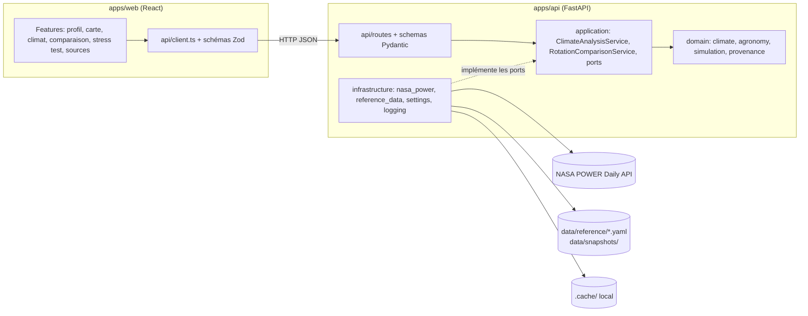
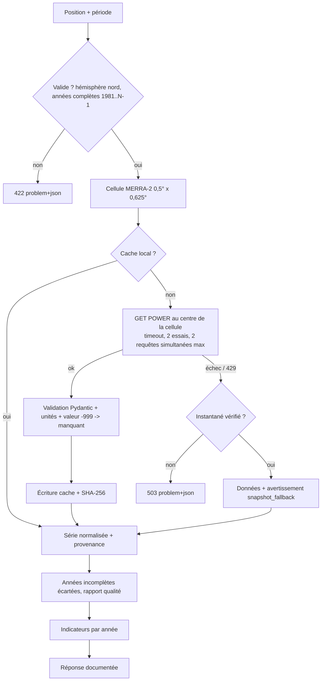
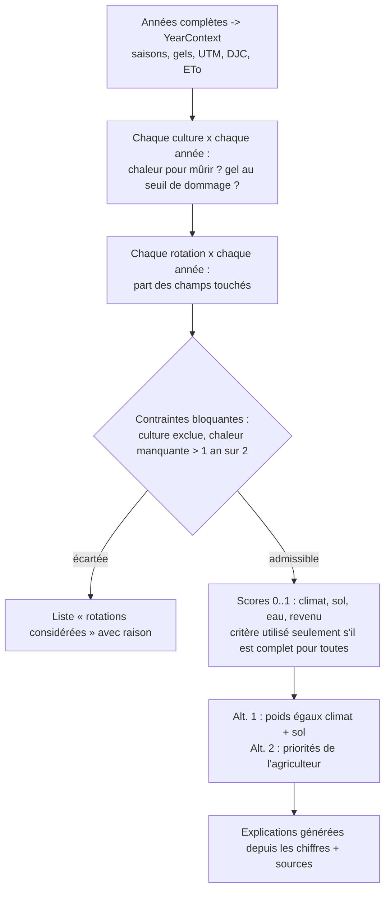
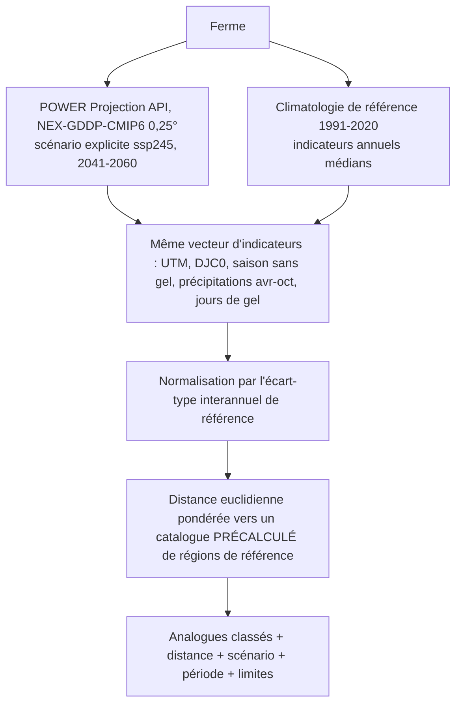

# Architecture

## 1. Synthèse des exigences

| Catégorie | Contenu |
|---|---|
| **Exigences du défi** | Combiner observations de la Terre NASA, sols, cultures et priorités de l'agriculteur ; comparer au moins 3 rotations dont l'actuelle ; expliquer pourquoi, données utilisées, bénéfices, risques, incertitudes ; ne pas se présenter comme un agronome automatisé. *Le texte officiel du défi (page rendue côté client) n'a pas pu être relu automatiquement : à revérifier par l'équipe, notamment la liste des ressources NASA suggérées.* |
| **Décisions de l'équipe** | Ferme de Sacré-Cœur comme profil principal ; MVP = profil, climat, comparaison, stress test historique, résultats ; jumeau climatique et économie en phase 2. |
| **Hypothèses** | Rotation actuelle interprétée comme avoine 1 an puis foin 2 ans ; position = centre de la municipalité ; priorités neutres faute de mesure ; un champ par phase de rotation. |
| **Choix techniques** | Monolithe modulaire ; FastAPI + Pydantic ; React + TypeScript ; NASA POWER Daily API ; fichiers versionnés plutôt qu'une base de données ; moteur déterministe à règles sourcées. |

## 2. Vue d'ensemble



Règle de dépendance : `api → application → domain` ; `infrastructure` implémente les contrats
(`application/ports.py`) et n'est assemblée que dans `api/dependencies.py`. Le domaine n'importe
ni FastAPI, ni Pydantic, ni httpx, ni YAML : c'est **testé** (`tests/unit/test_architecture.py`).

## 3. Pipelines

### Acquisition NASA (étapes 1 à 12)



La ferme n'est jamais envoyée à la NASA : seul le centre de la cellule (~50 km) l'est.

### Comparaison de rotations et stress test historique



### Jumeau climatique (phase 2, non implémenté)



Distance proposée : `d(f, r) = sqrt(Σ_i w_i ((x_i^f,2050 − x_i^r,actuel) / σ_i^r)²)`, avec `σ_i`
l'écart-type interannuel observé de l'indicateur `i` (unités comparables, « en années typiques
d'écart »), poids égaux par défaut. Le catalogue de régions est préparé hors ligne par un script
(jamais de téléchargement massif pendant une requête). Aucune affirmation de réussite des cultures
dans la région analogue sans données agricoles supplémentaires.

## 4. Arborescence

```
apps/api/src/fieldshift/
  domain/                      noyau métier pur, sans I/O
    geo.py                     GeoPoint, GridCell
    provenance.py              DatasetProvenance, DataQualityReport, origines et natures des données
    references.py              Reference (bibliographie)
    observation_checks.py      année signalée par l'agriculteur vs données
    climate/                   série quotidienne, formules (UTM, DJC, Ra, Hargreaves), saisons,
                               précipitations, statistiques (centiles, Mann-Kendall, Theil-Sen),
                               YearContext, registre d'indicateurs
    agronomy/                  Crop + exigences sourcées, FarmProfile, CropRotation, priorités,
                               validation, suitability (contrôles culture x année)
    simulation/                stress_test, assessment (contraintes, critères), explanations,
                               comparison (sélection des stratégies)
  application/                 cas d'usage + ports (Protocol) + erreurs applicatives
  infrastructure/              nasa_power (grid, client, parser, store, provider), reference_data,
                               settings, logging
  api/                         app (factory), dependencies (composition), errors, routes, schemas
apps/api/tests/                unit/ (formules, saisons, comparaison, architecture), integration/
                               (parseur sur réponse enregistrée, client simulé, cache/snapshot, API)
apps/web/src/
  api/                         client typé + schémas Zod + test de contrat sur réponses réelles
  features/                    farm-profile, climate-dashboard, rotation-comparison,
                               historical-simulation, data-sources
  components/ utils/           composants et formatage partagés
data/reference/                crops.yaml, rotation_templates.yaml, sources.yaml, demo_farms.yaml
data/snapshots/nasa-power/     réponses NASA brutes + .meta.json (URL, date, SHA-256)
```

## 5. Modèle de domaine

| Entité | Rôle et invariants |
|---|---|
| `FarmProfile` | Position + précision (exacte/approximative), rotation actuelle, priorités 0–3, sol/irrigation **optionnels** (`None` = inconnu), cultures exclues, observations verbatim. |
| `Crop` | Catégorie (annuelle, fourragère pérenne, pérenne ligneuse), familles, fixation d'azote (`None` = inconnu), modèle de saison ; exigences de chaleur, gel, eau **avec `Basis`** (sources, `documented`/`provisional`). Une valeur documentée sans source est refusée. |
| `CropRotation` | 1 à 8 années ; une pérenne ligneuse y est refusée. |
| `ClimateSeries` / `YearData` | Jours strictement croissants ; seules les années sans aucune valeur manquante sont analysées. |
| `YearContext` | Tout ce qui dérive d'une année (saisons, gels, cumuls), calculé une fois et partagé. |
| `IndicatorDefinition` | Identifiant, unité, définition en français, sources, fonction pure. |
| `CropYearOutcome`, `RotationStressTest` | Résultat de chaque règle par année ; distribution de l'exposition par rotation. |
| `EvaluatedRotation`, `CriterionScore` | Admissibilité, scores 0..1 et couverture des données. |
| `RecommendationExplanation` / `Statement` | Phrases typées (bénéfice, compromis, incertitude, à valider) liées à un critère et à des sources. |
| `DatasetProvenance`, `DataQualityReport` | Source, produit, version, période, date d'obtention, résolution, cellule, unités, origine (live/cache/instantané), nature (réanalyse ≠ projection), SHA-256, avertissements. |

Les schémas HTTP (`api/schemas`) sont distincts des entités et convertis explicitement.

## 6. Stratégie de données

- **Référentiel** : YAML versionnés, validés strictement au démarrage (clés inconnues, sources
  citées inexistantes, cultures inconnues → l'API refuse de démarrer).
- **Cache** : `.cache/nasa-power/`, clé = cellule + période + paramètres ; une réponse invalide
  n'est jamais mise en cache ; verrou par clé pour éviter les téléchargements concurrents.
- **Instantanés** : `data/snapshots/`, produits par le pipeline de production
  (`scripts/refresh_snapshot.py`), vérifiés par SHA-256 à chaque lecture.
- **Reproductibilité** : même instantané → mêmes chiffres (test d'API sur UTM 2024 = 2886 à
  Sacré-Cœur) ; lockfiles `uv.lock` et `package-lock.json` ; dépendances antérieures au 27/10/2026.
- **Persistance** : pas de base de données au MVP (voir ADR 0004).

## 7. Tests et CI

Pyramide : unitaires sur le noyau (valeurs publiées : matrice UTM d'OMAFRA, exemple 8 de la
FAO-56 ; années synthétiques aux résultats connus ; règles de sélection) → intégration (réponse
NASA enregistrée, client HTTP simulé, cache, repli sur instantané, falsification détectée, API de
bout en bout sur l'instantané réel) → frontend (contrat Zod sur réponses réelles, formatage).
E2E navigateur : à ajouter (Playwright, 2–3 parcours) — voir la feuille de route.
